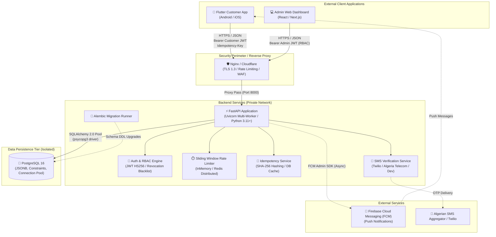

# KGP LIST — System Architecture & Communication Model (Phase 2B)

## 1. Executive Summary

**KGP LIST** is a mobile product catalog and ordering platform designed for a mobile phone spare-parts business in Algeria. The platform serves repair technicians, workshop owners, and retail buyers across all Algerian wilayas.

This document describes the high-level system architecture, client-backend communication protocols, authentication & authorization model, database persistence design, and push notification integration.

---

## 2. System Architecture Diagram

---

## 3. Communication Rules & Security Boundaries

### Rule 1: No Direct Database Access
- **Clients NEVER connect directly to PostgreSQL.**
- PostgreSQL is deployed inside an isolated private Docker bridge network (`kgp_internal_net`).
- Port `5432` is closed to the outside world in production.
- All database operations are mediated exclusively through validated FastAPI endpoints.

### Rule 2: HTTPS Everywhere
- All external communication between mobile apps, web browsers, and the API gateway must use **TLS 1.3 / HTTPS**.
- HTTP requests are redirected automatically to HTTPS.

### Rule 3: Centralized Environment-Driven Configuration
- The backend configuration is centralized in `app.core.config.Settings`.
- In production, wildcards (`*`) in CORS origins are strictly rejected.
- Weak secret keys (<32 characters) cause the application to abort startup.

### Rule 4: Structured Logging & Zero-Leakage Privacy
- Customer telephone numbers (`05xx`, `06xx`, `07xx`, `+213`) are automatically sanitized to `[REDACTED_PHONE]` via `SensitiveDataFilter`.
- Passwords, bearer tokens, and database credentials are redacted from logs.
- The health endpoint (`GET /api/health`) never exposes connection strings, internal paths, or environment variables.

---

## 4. Authentication, Authorization & RBAC (Phase 2B)

### 4.1. Administrator Authentication
- Authenticates via `POST /api/v1/auth/login` using email and salted bcrypt password.
- Issues short-lived signed JWT access tokens (`exp`: 12 hours, `sub`: admin ID, `role`: assigned RBAC role).
- Immediate revocation supported via `POST /api/v1/auth/logout`, registering token `jti` in `TokenRevocationService`.

### 4.2. Role-Based Access Control (RBAC)
Granular permissions are enforced on every administrative backend route:
- **`superadmin`**: Full administrative authority. Manages admin users (`/api/v1/admin/users`), manages catalog, manages orders, inspects audit logs.
- **`admin`**: Product and category management (`/api/v1/categories`, `/api/v1/products`), full order inspection and processing. Cannot provision other admin accounts.
- **`operator`**: Warehouse/order fulfillment staff. Can view catalog, view all orders, and transition order lifecycle statuses (`/api/v1/orders/{id}/status`). Cannot alter product prices, category hierarchies, or user accounts.

### 4.3. Customer Identity & Verification
- Mobile app customers verify ownership of Algerian mobile numbers via SMS OTP.
- `BaseSMSProvider` defines clean gateway abstraction for production aggregators (Twilio, Mobilis, Ooredoo, Djezzy).
- OTP codes are hashed with SHA-256 + cryptographic salt; raw passcodes are never stored.
- Max 3 incorrect verification attempts before challenge lockout.
- Customer JWT access tokens allow customers to view and manage their self-profile (`GET /api/v1/customers/me`) and placed orders.

### 4.4. Order Ownership & IDOR Prevention
- Order submission derives customer identity directly from authenticated token claims (`data.customer_id = current_customer.id`), rejecting client-spoofed IDs.
- Order listing and detail endpoints enforce strict customer scoping: customers can never access orders belonging to other shops.
- Viewing unauthorized order IDs returns `404 Not Found` to prevent resource enumeration.

### 4.5. Persistent Idempotency Subsystem
- Order submissions support the `Idempotency-Key` header to eliminate duplicate billing or order placement.
- Persisted in PostgreSQL table `idempotency_keys` with SHA-256 request payload hash.
- Network replays return cached results with `Idempotent-Replay: true`.
- Mismatched payloads using the same key are rejected with `409 Conflict`.

### 4.6. Extensible Rate Limiting
- Token bucket / sliding-window rate limiting protects critical endpoints against brute-force and scraping:
  - Admin login: 5 requests / min
  - Customer OTP requests: 3 requests / 10 min
  - Customer registration: 10 requests / min
  - Order placement: 30 requests / min
- Backed by `InMemoryRateLimiter` for local/single-worker environments and documented `RedisRateLimiter` for horizontal multi-worker clusters.
