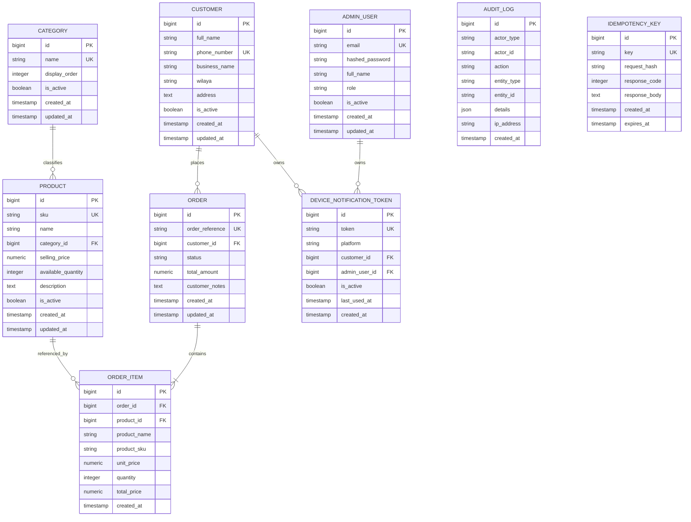

# KGP LIST — Data Model & Database Architecture

## 1. Overview

KGP LIST uses **PostgreSQL 16** managed through **SQLAlchemy 2.0** ORM and **Alembic** migrations. The schema is normalized, strictly typed, and enforced with table-level check constraints.

---

## 2. Entity Relationship Diagram (ERD)

---

## 3. Core Entities Detail

### 3.1. `products`
- **Purpose:** Spare-parts catalog items (Screens, Batteries, Flex cables, Charging boards, etc.).
- **Currency:** Algerian Dinars (DZD). Stored as `Numeric(12, 2)` to eliminate floating-point arithmetic rounding errors.
- **Constraints:**
  - `ck_products_selling_price_positive`: `selling_price >= 0`
  - `ck_products_quantity_positive`: `available_quantity IS NULL OR available_quantity >= 0`
- **Foreign Keys:** `category_id -> categories.id` with `ondelete="RESTRICT"` to prevent deleting categories with active products.

### 3.2. `orders` & `order_items` (Historical Snapshotting)
- **Immutable Historical Line Items:**
  When a customer places an order, the `order_items` record captures:
  - `product_name`
  - `product_sku`
  - `unit_price`
  - `quantity`
  - `total_price`
  
  **Why?** If an administrator renames a product from *"Samsung A51 Screen"* to *"Samsung A51 Screen OEM Refurbished"* or increases its price from `14,500.00 DZD` to `16,000.00 DZD`, previously submitted customer orders must **never** change.

- **Deletions / Discontinuations:**
  - `product_id` in `order_items` is configured with `ondelete="SET NULL"`. If a product is retired or deleted, the historical invoice and line item records remain intact for accounting.
  - `order_id` uses `ondelete="CASCADE"`. If an order is purged, its line items are cleaned up.

### 3.3. `customers`
- **Purpose:** Store owners, repair technicians, and retail customers.
- **Validation:** Algerian phone numbers are validated to ensure standard format (`05`, `06`, `07`, or `+213` with 8 digits).

### 3.4. `device_notification_tokens`
- **Purpose:** Store Firebase Cloud Messaging (FCM) registration tokens for customer Android devices and admin web/mobile clients.
- **Foreign Keys:** Soft cascades on `customer_id` or `admin_user_id`.

### 3.5. `audit_logs`
- **Purpose:** Security and auditability.
- **Attributes:** Captures actor type (`ADMIN`, `CUSTOMER`, `SYSTEM`), actor ID, entity modified, action performed, payload details (JSON), and IP address.

### 3.6. `idempotency_keys`
- **Purpose:** Duplicate request suppression and safe response replay.
- **Attributes:**
  - `key`: Unique client-supplied idempotency token (UUID).
  - `request_hash`: SHA-256 hash of `path|customer_id|payload` used to detect payload tampering or key reuse.
  - `response_code`: Cached HTTP status code (e.g. 201).
  - `response_body`: Cached JSON response payload.
  - `expires_at`: Expiration timestamp (default 24-hour retention).
- **Indexes:** Indexed on `key` (unique), `request_hash`, and `expires_at`.
